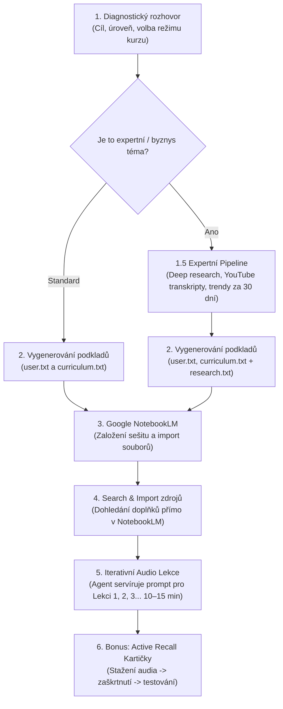

# 🧠 Learning System Agent (Systém pro naučení čehokoliv)

[](https://github.com/jardaakarb/learning-system-agent)
[](#)
[](https://notebooklm.google.com)

> **Ověřený systém učení v uzavřené smyčce:** Původně vznikl jako záchranný systém, díky kterému se podařilo zvládnout **4 roky zanedbaného studia a 75 komplexních zkouškových otázek za méně než měsíc** a odmaturovat na jedničky a dvojky.
> 
> Nyní zabalený do **jednoho agentního skillu**, který vás provede celým procesem od nuly.

---

## ⚡ Jak tento repozitář použít

Tento repozitář je navržen tak, aby fungoval **na jedno kliknutí nebo zkopírování odkazu** v jakémkoliv moderním AI agentovi i běžném chatu.

### Možnost 1: V Claude Code nebo Antigravity CLI
Stačí do příkazové řádky zadat odkaz na toto repo:
```bash
# V Claude Code nebo Antigravity:
"Nainstaluj nebo spusť skill z https://github.com/jardaakarb/learning-system-agent"
```
Agent si automaticky stáhne [SKILL.md](SKILL.md) a zahájí s vámi diagnostický rozhovor.

### Možnost 2: V Cursor / Windsurf / GitHub Copilot
Přidejte odkaz na repo nebo zkopírujte obsah [SKILL.md](SKILL.md) do systémového kontextu (např. do souboru `.cursorrules` nebo přímo do chatu).

### Možnost 3: Přímo ve webovém chatu (ChatGPT, Claude, Gemini)
Pokud nepoužíváte kódovacího agenta, otevřete soubor [SKILL.md](SKILL.md), zkopírujte jeho text a vložte jej jako první zprávu do chatu s AI. Ta se okamžitě začne chovat podle tohoto systému.

---

## 🔄 Jak celý proces funguje



---

## 🚀 Krok za krokem: Co se bude dít

### 1. Diagnostický rozhovor & Volba režimu
Agent se vás v češtině zeptá na to podstatné:
- **Co přesně se chcete naučit** (školní předmět, certifikace, jazyk, nebo byznys téma jako monetizace AI agentů).
- **Jaká je vaše současná úroveň** (úplný začátečník vs. mírně pokročilý).
- **Jaký je váš cíl** (maturita/zkouška, pracovní pohovor, vybudování příjmu z praxe).
- **Volba režimu kurzu:**
  - *Standardní režim:* Pro běžná akademická a teoretická témata.
  - *Expertní režim (Deep Research):* Pro praktická, byznysová a technologická témata, kde nestačí obecná Wikipedie.

### 1.5 🔬 Expertní režim: Deep Research Pipeline (Volitelný krok)
Pokud jde o byznys nebo praktické téma (např. *jak vydělat na AI agentech*), agent nevaří osnovu z vody. Místo toho autonomně spustí řetězec specializovaných nástrojů:
1. **Hloubkový webový scraping (`firecrawl-deep-research`):** Prozkoumá případové studie a technické blogy špičkových autorit.
2. **Extrakce YouTube přepisů (`baoyu-youtube-transcript`):** Stáhne kompletní přepisy klíčových praktických masterclasses z YouTube.
3. **Průzkum trhu za 30 dní (`last30days`):** Vytěží z komunit na Redditu a X aktuální fungující postupy a varování před chybami.
4. **Master dokument `research.txt`:** Vše syntetizuje do 3 000 až 8 000+ slov konkrétního know-how z praxe (nabídky, ceny, stack, prodej).

### 2. Vygenerování řídicích souborů
Agent na základě diagnostiky (a případného expertního researche) vygeneruje:
- **`user.txt` (User Profile):** Příběhový profil popisující vaše zázemí, cíle a slabá místa.
- **`curriculum.txt` (Curriculum):** Strukturovaná osnova rozdělená do 5 až 20 témat (v expertním režimu 100% ukotvená v `research.txt`).
- **`research.txt` (pouze v expertním režimu):** Plná znalostní báze od světových špiček.

### 3. Založení sešitu v Google NotebookLM
Otevřete [notebooklm.google.com](https://notebooklm.google.com) (zdarma s Google účtem), založíte nový sešit a nahrajete soubory `user.txt` a `curriculum.txt`.

### 4. 🔍 Klíčový trik: Search & Import zdrojů přímo v NotebookLM
Nemusíte trávit hodiny sháněním učebnic:
1. Agent vám při přechodu do této fáze vypíše každé téma v samostatném kódovém bloku – stačí kliknout na tlačítko **Zkopírovat (Copy)** u Tématu 1.
2. V levém panelu NotebookLM u zdrojů kliknete na ikonku **Vyhledat na webu nové zdroje** (nebo *Přidat zdroj → Vyhledat na webu*).
3. Vložíte zkopírované téma do vyhledávání a kliknete na **Vyhledat**.
4. Následně kliknete na **Importovat** pro přidání nalezených materiálů.
5. 💡 *Poznámka:* Pokud jsou některé zdroje zabarvené **červeně**, vůbec to nevadí a nemusíte to řešit.
6. 💡 *Tip:* Nemusíte to dělat hned pro všechna témata dopředu – stačí mít stažené zdroje vždy pro to téma, ze kterého chcete právě generovat audio lekci.

### 5. 🎧 Servírování audio lekcí (Lekce po lekci bez opakování)
Agent vám naservíruje hotový prompt přímo pro **Lekci 1**:
- V pravém panelu NotebookLM u **Audio Overview (Audio přehled)** kliknete na **Přizpůsobit (Customize)**.
- **Zaškrtnete jazyk: Čeština.** Jinak nic neměníte!
- Vložíte zkopírovaný prompt od agenta a kliknete na **Vygenerovat (Generate)**.
- Během 2–4 minut vznikne interaktivní podcastová diskuse dvou mentorů nastavená na optimální délku **10 až 15 minut** (žádné úmorné 25minutové monology).
- 💡 **Trik proti opakování informací:** Až si Lekci 1 doposlechnete, stáhněte si ji (nebo zkopírujte její textový přepis) a nahrajte ji zpět do levého sloupce zdrojů pod názvem `1` (nebo `lekce-1`). Následně napište agentovi *„Mám hotovo / Dej mi další“*. Agent připraví prompt pro Lekci 2, který díky tomu přesně ví, co už bylo řečeno, a nebude opakovat stejné úvodní příklady dokola.

### 6. 🗂️ Bonus: Active Recall kartičky na vyzkoušení
Pokud si chcete ověřit, že principům skutečně rozumíte:
1. Vygenerovanou audio lekci si stáhnete (tři tečky `...` → *Stáhnout*).
2. Nahrajete audio zpět do zdrojů v NotebookLM.
3. V levém sloupci **zaškrtnete POUZE toto nahrané audio**.
4. Vložíte náš bonusový prompt do chatu. NotebookLM vám z audia vygeneruje 15–20 principiálních otázek na kauzalitu, fungování a praktické scénáře.

---

## 📁 Struktura repozitáře

```
├── SKILL.md                          # Plná specifikace dovednosti pro AI agenty
├── README.md                         # Tento průvodce
├── prompts/
│   ├── audio_mentor_prompt.md        # Prompt pro Audio Overview (Customize)
│   └── flashcards_bonus_prompt.md    # Bonusový prompt pro Active Recall kartičky
└── templates/
    ├── user_profile_template.md      # Vzorový soubor user profile
    └── curriculum_template.md        # Vzorové kurikulum
```

---

## 👤 Autor
Vytvořil **Jaroslav Karban** ([GitHub: @jardaakarb](https://github.com/jardaakarb)).  
Systém postavený na reálných zkušenostech s rychlým studiem a moderními AI technologiemi.
