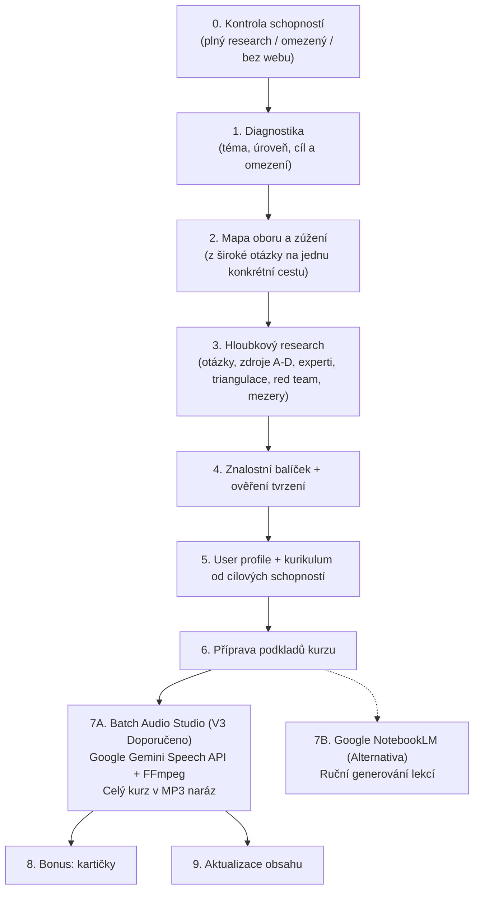

# 🧠 Learning System Agent (Systém pro naučení čehokoliv)

[](https://github.com/jardaakarb/learning-system-agent)
[](#)
[](https://ai.google.dev)
[](https://notebooklm.google.com)

> **Ověřený systém učení v uzavřené smyčce:** Původně vznikl jako záchranný systém, díky kterému se podařilo zvládnout **4 roky zanedbaného studia a 75 komplexních zkouškových otázek za méně než měsíc** a odmaturovat na jedničky a dvojky.
>
> Nyní zabalený do **jednoho agentního skillu**, který vás provede celým procesem od research přes kurikulum až po **automatické generování audio podcastů v češtině**.

**Verze 3:** Odstraňuje vyčerpávající manuální klikání v NotebookLM. Nové **Batch Audio Studio** vygeneruje celou sérii 10–15 minutových hloubkových lekcí naráz do MP3 přes Google Gemini Speech API s automatickou kontinuitou a živou lidskou češtinou. Přehled změn je v [CHANGELOG.md](CHANGELOG.md).

---

## ⚡ Jak tento repozitář použít

### Možnost 1: V Claude Code nebo Antigravity CLI
```bash
"Nainstaluj nebo spusť skill z https://github.com/jardaakarb/learning-system-agent"
```
Agent si načte [SKILL.md](SKILL.md), provede diagnostiku a research, připraví znalostní balíček a spustí dávkové audio studio.

### Možnost 2: V Cursor / Windsurf / GitHub Copilot
Přidejte odkaz na repo nebo zkopírujte obsah [SKILL.md](SKILL.md) do systémového kontextu (např. `.cursorrules`).

### Možnost 3: Přímo ve webovém chatu (ChatGPT, Claude, Gemini)
Zkopírujte text [SKILL.md](SKILL.md) a vložte ho jako první zprávu.

---

## 🔄 Jak celý proces funguje



---

## 🎙️ Verze 3: Batch Audio Studio

Už žádné čekání u webu NotebookLM a ruční přetahování promptů. Skript `scripts/generate_audio_batch.py`:
1. **Organický obsahový dialog (žádná rigidní šablona):** Žádné umělé škatulkování do 4 aktů. Rozhovor plyne přirozeně a věcně podle toho, co je potřeba předat, bez formálních omáček.
2. **Vestavěný Humanizer anti-slop filtr:** Každá replika před převodem na řeč povinně projde filtrem dovednosti `/humanizer`. Odstraní se chatbotové manýry (úvodní přikyvování, fráze „Není to o X ale o Y", nucené trojice, strojené úvody a AI klišé).
3. **Dávkování po milnících:** Kurikulum se po prvních reálných konverzacích se zákazníky a praxi přirozeně vyvíjí. Proto je doporučeno generovat po milnících (1–2 lekce), ověřit je v praxi a až poté pokračovat.
4. **Živá čeština bez syntetického plechu:** Moderátoři **Petr (hlas: Fenrir)** a **Elena (hlas: Aoede)** mluví přirozenou, lidskou češtinou přes Google Gemini Speech API.
5. **Automatická kontinuita:** Skript si předává *Continuity Ledger*. Další modul navazuje na minulý bez opakování základních definic, metafor či vesnických příkladů.
6. **Okamžitá postprodukce přes FFmpeg:** Vložení přirozených mikropauz (300 ms), normalizace a komprese do 192 kbps MP3.

### Použití:
```bash
# Doporučeno: vygenerování prvního milníku (např. lekce 1 a 2)
python scripts/generate_audio_batch.py --course-dir kurz-<téma> --modules 1-2

# Vygenerování konkrétní lekce
python scripts/generate_audio_batch.py --course-dir kurz-<téma> --modules 1

# Vygenerování celého kurzu naráz
python scripts/generate_audio_batch.py --course-dir kurz-<téma> --duration 12
```

---

## 📁 Struktura repozitáře

```
├── SKILL.md                          # Plná specifikace dovednosti (v3)
├── README.md                         # Tento průvodce
├── CHANGELOG.md                      # Historie verzí (v1 -> v2 -> v3)
├── scripts/
│   └── generate_audio_batch.py       # Dávkový generátor scénářů a MP3 podcastů
├── prompts/
│   ├── podcast_scriptwriter_v3.md    # 4-aktový prompt pro skriptovací engine
│   ├── audio_mentor_prompt.md        # Prompt pro manuální NotebookLM (fallback)
│   ├── flashcards_bonus_prompt.md    # Prompt pro kartičky
│   └── deep_research_prompt.md       # Záložní research prompt pro režim bez webu
├── references/
│   ├── research-playbook.md          # Šablony poznámek, ledger, vzory dotazů
│   └── domain-lenses.md              # Doménové čočky (byznys, tech, právo...)
└── templates/
    ├── user_profile_template.md
    ├── curriculum_template.md
    └── knowledge_pack_template.md
```

---

## 👤 Autor
Vytvořil **Jaroslav Karban** ([GitHub: @jardaakarb](https://github.com/jardaakarb)).
Systém postavený na reálných zkušenostech s rychlým studiem a moderními AI technologiemi.
