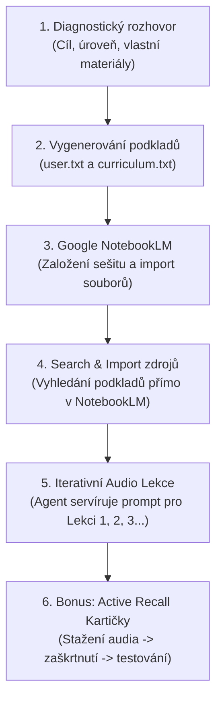

# 🧠 Learning System Agent (Systém pro naučení čehokoliv)

[](https://github.com/jardaakarb/learning-system-agent)
[](#)
[](https://notebooklm.google.com)

> **Ověřený systém učení v uzavřené smyčce:** Původně vznikl jako záchranný systém, díky kterému se podařilo zvládnout **4 roky zanedbaného studia a 75 komplexních zkouškových otázek za méně než měsíc** a odmaturovat na jedničky a dvojky.
> 
> Nyní zabalený do **jednoho agentního skillu**, který vás provede celým procesem od nuly.

---

## ⚡ Jak tento repozitář použít

Tento repozitář je navržen tak, aby fungoval **na jedno kliknutí nebo zkopírování odkazu** v jakémkoliv moderním AI agentovi i běžném chatu.

### Možnost 1: V Claude Code nebo Antigravity CLI
Stačí do příkazové řádky zadat odkaz na toto repo:
```bash
# V Claude Code nebo Antigravity:
"Nainstaluj nebo spusť skill z https://github.com/jardaakarb/learning-system-agent"
```
Agent si automaticky stáhne [SKILL.md](SKILL.md) a zahájí s vámi diagnostický rozhovor.

### Možnost 2: V Cursor / Windsurf / GitHub Copilot
Přidejte odkaz na repo nebo zkopírujte obsah [SKILL.md](SKILL.md) do systémového kontextu (např. do souboru `.cursorrules` nebo přímo do chatu).

### Možnost 3: Přímo ve webovém chatu (ChatGPT, Claude, Gemini)
Pokud nepoužíváte kódovacího agenta, otevřete soubor [SKILL.md](SKILL.md), zkopírujte jeho text a vložte jej jako první zprávu do chatu s AI. Ta se okamžitě začne chovat podle tohoto systému.

---

## 🔄 Jak celý proces funguje



---

## 🚀 Krok za krokem: Co se bude dít

### 1. Diagnostický rozhovor
Agent se vás v češtině zeptá na to podstatné:
- **Co přesně se chcete naučit** (konkrétní předmět, technologie, obor, certifikace, jazyk).
- **Jaká je vaše současná úroveň** (úplný začátečník vs. mírně pokročilý).
- **Jaký je váš cíl** (maturita/zkouška, pracovní pohovor, praktický projekt).
- **Vlastní materiály:** Můžete do chatu vložit skripta, školní osnovu, poznámky nebo odkazy.

### 2. Vygenerování řídicích souborů
Agent na základě vašich odpovědí vygeneruje dva soubory:
- **`user.txt` (User Profile):** Příběhový profil popisující vaše zázemí, cíle, slabá místa a preferovaný styl výkladu.
- **`curriculum.txt` (Curriculum):** Strukturovaná osnova rozdělená do 5 až 20 témat, postavená na ověřených oborových konceptech.

### 3. Založení sešitu v Google NotebookLM
Otevřete [notebooklm.google.com](https://notebooklm.google.com) (zdarma s Google účtem), založíte nový sešit a nahrajete soubory `user.txt` a `curriculum.txt`.

### 4. 🔍 Klíčový trik: Search & Import zdrojů přímo v NotebookLM
Nemusíte trávit hodiny sháněním učebnic:
1. Z vygenerovaného kurikula vezmete **Téma 1** (včetně podbodů) a zkopírujete jej.
2. V NotebookLM kliknete na **Přidat zdroj (+)** → **Vyhledat na webu (Web search)**.
3. Vložíte téma, necháte NotebookLM najít odborné podklady a kliknete na **Importovat do zdrojů**.
4. Zopakujete pro Téma 2, 3 atd. Tím získá váš sešit neprůstřelnou faktickou základnu pro každou kapitolu.

### 5. 🎧 Servírování audio lekcí (Lekce po lekci)
Agent vám naservíruje hotový prompt přímo pro **Lekci 1**:
- Zkopírujete prompt do pole **Audio Overview → Přizpůsobit (Customize)** v NotebookLM.
- Během pár minut vznikne interaktivní podcastová diskuse dvou mentorů, kteří probírají přesně vaše téma, vysvětlují *proč a jak* věci fungují a reagují na vaše konkrétní otázky z profilu.
- Po poslechu napíšete agentovi: *„Mám hotovo / Dej mi další“*. Agent vám okamžitě připraví **Lekci 2**, která začíná rekapitulací a přirozeně navazuje.

### 6. 🗂️ Bonus: Active Recall kartičky na vyzkoušení
Pokud si chcete ověřit, že principům skutečně rozumíte:
1. Vygenerovanou audio lekci si stáhnete (tři tečky `...` → *Stáhnout*).
2. Nahrajete audio zpět do zdrojů v NotebookLM.
3. V levém sloupci **zaškrtnete POUZE toto nahrané audio**.
4. Vložíte náš bonusový prompt do chatu. NotebookLM vám z audia vygeneruje 15–20 principiálních otázek na kauzalitu, fungování a praktické scénáře.

---

## 📁 Struktura repozitáře

```
├── SKILL.md                          # Plná specifikace dovednosti pro AI agenty
├── README.md                         # Tento průvodce
├── prompts/
│   ├── audio_mentor_prompt.md        # Prompt pro Audio Overview (Customize)
│   └── flashcards_bonus_prompt.md    # Bonusový prompt pro Active Recall kartičky
└── templates/
    ├── user_profile_template.md      # Vzorový soubor user profile
    └── curriculum_template.md        # Vzorové kurikulum
```

---

## 👤 Autor
Vytvořil **Jaroslav Karban** ([GitHub: @jardaakarb](https://github.com/jardaakarb)).  
Systém postavený na reálných zkušenostech s rychlým studiem a moderními AI technologiemi.
